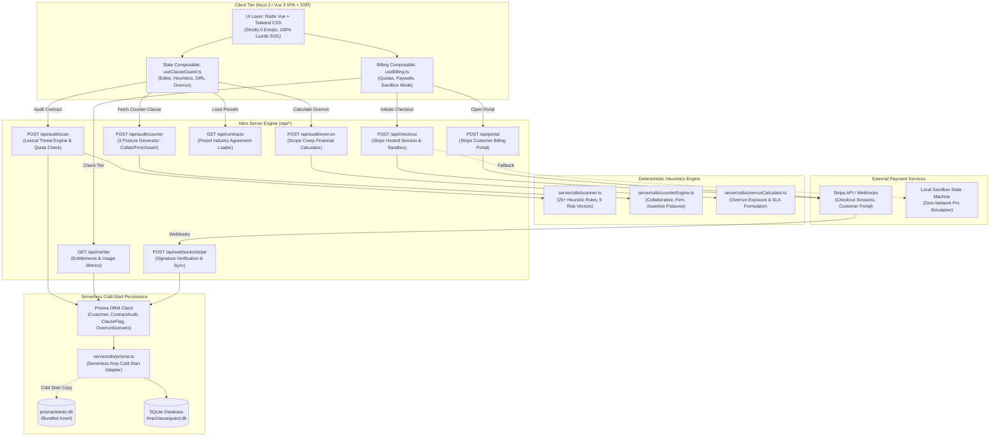
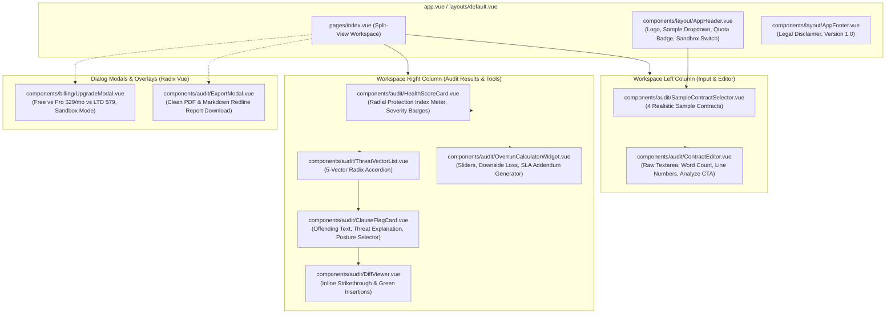

# Technical Architecture Specification: ClauseGuard Studio
**System Architecture & Implementation Blueprint**  
**Standards 4.0 Autonomous Software Studio Specification**  
**Target Repository:** `/Users/muttaqi/ai-engineering-team/projects/clause-guard-studio`  
**Document Version:** 1.0.0 — Production Grade  

---

## 1. Executive Technical Vision & System Overview

### 1.1 Architectural Thesis
**ClauseGuard Studio** is an offline-resilient, deterministic contract risk auditor, toxic clause redliner, and protective counter-clause generator engineered for independent software engineers, consultants, and boutique digital agencies. 

Under Standards 4.0, the architecture departs decisively from opaque, high-latency, third-party LLM inference APIs. Instead, ClauseGuard Studio employs a **privacy-first, deterministic lexical heuristics engine** capable of executing 25+ pattern scans across 5 critical risk vectors in under 15 milliseconds. Contract text is analyzed entirely on-device or within an isolated, ephemeral serverless micro-runtime, guaranteeing that client confidential agreements and proprietary intellectual property are never leaked or used for external model training.

The system combines:
1. **Nuxt 3 (v3.14+) & Nitro Server Engine**: Unified full-stack TypeScript framework providing server-side rendering, instant hydration, and serverless edge API endpoints.
2. **Radix Vue (`radix-vue`) & Bespoke Tailwind Art Direction**: Unstyled, fully accessible headless primitives (Dialogs, Tabs, Accordions, Tooltips, Dropdowns) styled with a high-craft **Warm Parchment** editorial aesthetic inspired by Swiss legal typography.
3. **Prisma ORM with SQLite Serverless Cold-Start Adapter**: Portable, self-contained relational storage utilizing an atomic `/tmp` cold-start replication layer with a bundled `prisma/starter.db` template.
4. **Built-in Monetization Engine**: First-class Stripe billing pipeline (`/api/checkout`, `/api/webhooks/stripe`, `/api/portal`) paired with a zero-credential **Interactive Sandbox Simulator** allowing instant preview of Pro features without external network calls.

### 1.2 System Component Diagram



---

## 2. Complete schema.prisma Specification

The persistence layer uses SQLite via Prisma ORM, engineered to operate seamlessly within ephemeral serverless filesystems (`/tmp`). The schema tracks customer subscriptions, audit histories, individual clause flags, and calculated scope-creep overrun scenarios.

```prisma
// datasource and generator definition
datasource db {
  provider = "sqlite"
  url      = env("DATABASE_URL")
}

generator client {
  provider = "prisma-client-js"
}

// -----------------------------------------------------------------------------
// Customer Model
// Represents the authenticated user, session, or enterprise tenant.
// Tracks active tier (FREE, PRO, LIFETIME), quota usage, and Stripe billing keys.
// -----------------------------------------------------------------------------
model Customer {
  id               String          @id @default(cuid())
  email            String          @unique
  stripeCustomerId String?         @unique
  subscriptionId   String?         @unique
  tier             String          @default("FREE") // "FREE" | "PRO" | "LIFETIME"
  usageCount       Int             @default(0)      // Current 30-day billing cycle scans
  quotaLimit       Int             @default(3)      // 3 for FREE; 999999 for PRO/LIFETIME
  createdAt        DateTime        @default(now())
  updatedAt        DateTime        @updatedAt

  // Relationships
  audits           ContractAudit[]

  @@index([email])
  @@index([stripeCustomerId])
}

// -----------------------------------------------------------------------------
// ContractAudit Model
// Records a contract review session, raw text payload, and calculated health metrics.
// -----------------------------------------------------------------------------
model ContractAudit {
  id              String            @id @default(cuid())
  customerId      String
  title           String            @default("Untitled Commercial Agreement")
  contractType    String            // "msa" | "sow" | "retainer" | "nda" | "custom"
  rawText         String            // Sanitized source agreement text
  overallScore    Int               // 0 - 100 Protection Index
  riskLevel       String            // "CRITICAL" | "WARNING" | "SAFE"
  createdAt       DateTime          @default(now())
  updatedAt       DateTime          @updatedAt

  // Relationships
  customer        Customer          @relation(fields: [customerId], references: [id], onDelete: Cascade)
  clauseFlags     ClauseFlag[]
  overrunScenario OverrunScenario?

  @@index([customerId])
  @@index([createdAt])
}

// -----------------------------------------------------------------------------
// ClauseFlag Model
// Detailed record of each predatory or non-standard clause detected during analysis.
// Stores original text, explanatory risk analysis, and 3 calibrated counter-clauses.
// -----------------------------------------------------------------------------
model ClauseFlag {
  id                        String        @id @default(cuid())
  auditId                   String
  originalText              String        // Offending text snippet extracted from contract
  clauseType                String        // "liability" | "scope" | "payment" | "ip" | "restrictive"
  severity                  String        // "CRITICAL" | "WARNING" | "SAFE"
  explanation               String        // Plain-English legal risk advisory
  counterClauseCollaborative String        // Gentle / relational replacement phrasing
  counterClauseFirm         String        // Industry-standard protective replacement phrasing
  counterClauseAssertive    String        // Hard-line enterprise-protective replacement phrasing
  createdAt                 DateTime      @default(now())

  // Relationships
  audit                     ContractAudit @relation(fields: [auditId], references: [id], onDelete: Cascade)

  @@index([auditId])
  @@index([clauseType])
  @@index([severity])
}

// -----------------------------------------------------------------------------
// OverrunScenario Model
// Financial model capturing potential scope creep downside and protective SLA rates.
// -----------------------------------------------------------------------------
model OverrunScenario {
  id                 String        @id @default(cuid())
  auditId            String        @unique
  baseFee            Float         // Fixed quoted project fee ($)
  includedRevisions  Int           // Maximum revision cycles included in base fee
  hourlyOverrunRate  Float         // Mandated overrun rate for extra revisions ($/hr)
  calculatedDownside Float         // Financial revenue exposure from unbilled hours ($)
  bufferFee          Float         // Recommended scope-containment contingency fee ($)
  createdAt          DateTime      @default(now())

  // Relationships
  audit              ContractAudit @relation(fields: [auditId], references: [id], onDelete: Cascade)
}
```

---

## 3. Exact Directory and File Tree Layout

```
clause-guard-studio/
├── .env.example                               # Environment variable templates (Stripe, DB, App)
├── .gitignore                                 # Git ignore patterns (node_modules, .nuxt, /tmp)
├── nuxt.config.ts                             # Nuxt 3 configuration (Tailwind, Radix, SSR, Nitro)
├── package.json                               # Dependencies and npm scripts
├── tsconfig.json                              # TypeScript strict configuration
├── tailwind.config.ts                         # Bespoke Warm Parchment design tokens & typography
├── ARCHITECTURE.md                            # Complete System Architecture Specification (This File)
├── PRD.md                                     # Product Requirements Document
├── CONCEPT.md                                 # Core Concept & Vision Document
│
├── prisma/
│   ├── schema.prisma                          # Complete Prisma SQLite Schema
│   ├── starter.db                             # Bundled pre-migrated SQLite DB template for cold starts
│   └── seed.ts                                # Seeding script for sample customers and contracts
│
├── server/
│   ├── api/
│   │   ├── audit/
│   │   │   ├── scan.post.ts                   # POST /api/audit/scan (Lexical risk analysis)
│   │   │   ├── counter.post.ts                # POST /api/audit/counter (Counter-clause generator)
│   │   │   └── overrun.post.ts                # POST /api/audit/overrun (Scope creep calculation)
│   │   ├── contracts/
│   │   │   └── index.get.ts                   # GET /api/contracts (Sample contract templates)
│   │   ├── checkout.post.ts                   # POST /api/checkout (Stripe session / sandbox)
│   │   ├── webhooks/
│   │   │   └── stripe.post.ts                 # POST /api/webhooks/stripe (Stripe webhook handler)
│   │   ├── portal.post.ts                     # POST /api/portal (Stripe billing portal generator)
│   │   └── me/
│   │       └── tier.get.ts                    # GET /api/me/tier (Quota & entitlement status)
│   │
│   ├── utils/
│   │   ├── prisma.ts                          # Serverless /tmp cold-start SQLite adapter
│   │   ├── stripe.ts                          # Stripe SDK client & webhook signature verification
│   │   ├── scanner.ts                         # 25+ Deterministic heuristics across 5 threat vectors
│   │   ├── counterEngine.ts                   # 3-Posture counter-clause generator engine
│   │   └── overrunCalculator.ts               # Financial scope-creep calculation engine
│   │
│   └── data/
│       └── sampleContracts.ts                 # Realistic MSA, SOW, Retainer, and NDA contract texts
│
├── composables/
│   ├── useClauseGuard.ts                      # Central contract audit, diff, & posture state
│   └── useBilling.ts                          # Quota tracking, paywall gating, & sandbox management
│
├── types/
│   ├── index.ts                               # Shared domain models & API response interfaces
│   ├── contract.ts                            # Audit, ClauseFlag, ThreatVector, & Posture types
│   └── billing.ts                             # Customer, Tier, Quota, & Stripe checkout types
│
├── assets/
│   └── css/
│       └── main.css                           # Tailwind CSS directives, typography, & custom utilities
│
├── components/
│   ├── ui/                                    # Headless Radix Vue styled primitives
│   │   ├── Dialog.vue                         # Accessible modal container (radix-vue/Dialog)
│   │   ├── Dropdown.vue                       # Accessible select/menu (radix-vue/DropdownMenu)
│   │   ├── Tabs.vue                           # Posture tabs (radix-vue/Tabs)
│   │   ├── Accordion.vue                      # Threat vector accordion (radix-vue/Accordion)
│   │   ├── Tooltip.vue                        # Glossary tooltips (radix-vue/Tooltip)
│   │   ├── Slider.vue                         # Numeric input sliders (radix-vue/Slider)
│   │   └── Toast.vue                          # Status notifications
│   │
│   ├── audit/                                 # Core contract auditing workspace components
│   │   ├── ContractEditor.vue                 # Split-pane contract input with line numbers & badges
│   │   ├── SampleContractSelector.vue         # 1-Click pre-loaded contract loader dropdown
│   │   ├── HealthScoreCard.vue                # Radial protection index gauge & high-level stats
│   │   ├── ThreatVectorList.vue               # 5-Vector interactive risk breakdown
│   │   ├── ClauseFlagCard.vue                 # Offending clause card with severity pill & diff toggle
│   │   ├── CounterClauseDrawer.vue            # 3-Posture negotiation card with 1-click copy
│   │   ├── DiffViewer.vue                     # Inline visual strikethrough/insertion comparison
│   │   └── OverrunCalculatorWidget.vue        # Financial exposure calculator & SLA clause addendum
│   │
│   ├── billing/                               # Commercial monetization components
│   │   ├── UpgradeModal.vue                   # Pricing tier modal (Free vs Pro $29/mo vs LTD $79)
│   │   ├── UpgradePromptBanner.vue            # Sticky inline paywall trigger for locked features
│   │   ├── SandboxToggleSwitch.vue            # Instant zero-network Pro tier simulation switch
│   │   └── TierStatusBadge.vue                # Navigation quota badge (e.g., "2/3 Audits Left")
│   │
│   └── layout/                                # Structural shell components
│       ├── AppHeader.vue                      # Brand logo, sample dropdown, tier badge, sandbox toggle
│       ├── AppFooter.vue                      # Legal disclaimers, version, copyright, & links
│       └── Container.vue                      # Centered maximum-width container wrapper
│
├── pages/
│   └── index.vue                              # Primary application workspace (Split-view auditor)
│
└── app.vue                                    # Root application shell (Head, Meta, Font, Toasts)
```

---

## 4. Nitro Server API Route Specifications & Contracts

### 4.1 `POST /api/audit/scan`
- **Purpose:** Ingests raw contract text, validates payload length, executes the deterministic 25+ pattern scanner across 5 risk vectors, calculates the Protection Index score, checks and increments customer monthly quota, and persists audit results.
- **Access Level:** Public / Authenticated. Free tier limited to 3 scans per 30-day window; Pro/Lifetime unlimited.

#### Request Headers & Body
```typescript
// Content-Type: application/json
// x-customer-email: "client@example.com" (Optional; defaults to anonymous guest session)

interface ScanContractRequest {
  title?: string;
  contractType: 'msa' | 'sow' | 'retainer' | 'nda' | 'custom';
  rawText: string;
}
```

#### Example Request
```json
{
  "title": "Enterprise Cloud Migration MSA",
  "contractType": "msa",
  "rawText": "Contractor shall indemnify, defend, and hold harmless Client from any and all claims without limitation. Payment to Contractor is contingent upon Client receiving payment from the end customer. Ownership of all Work Product vests in Client immediately upon creation."
}
```

#### Response Schemas
##### 200 OK (Audit Successful)
```typescript
interface ScanContractResponse {
  auditId: string;
  title: string;
  contractType: string;
  characterCount: number;
  wordCount: number;
  protectionIndex: number; // 0 - 100
  riskLevel: 'CRITICAL' | 'WARNING' | 'SAFE';
  summary: {
    criticalCount: number;
    warningCount: number;
    safeCount: number;
  };
  vectorBreakdown: {
    vectorId: string; // 'liability' | 'scope' | 'payment' | 'ip' | 'restrictive'
    name: string;
    riskScore: number; // 0 - 100
    flagCount: number;
  }[];
  flags: {
    id: string;
    originalText: string;
    clauseType: string;
    severity: 'CRITICAL' | 'WARNING' | 'SAFE';
    explanation: string;
    // Blurred preview if customer is FREE tier; full text if PRO/LIFETIME
    counterClauseCollaborative: string;
    counterClauseFirm: string;
    counterClauseAssertive: string;
    isLocked: boolean;
  }[];
  customer: {
    tier: 'FREE' | 'PRO' | 'LIFETIME';
    usageCount: number;
    quotaLimit: number;
    remainingScans: number;
  };
}
```

##### 402 Payment Required (Quota Exceeded)
```json
{
  "statusCode": 402,
  "statusMessage": "Monthly Quota Exceeded",
  "data": {
    "tier": "FREE",
    "usageCount": 3,
    "quotaLimit": 3,
    "message": "You have utilized all 3 complimentary monthly contract scans. Upgrade to Pro for unlimited audits."
  }
}
```

##### 400 Bad Request
```json
{
  "statusCode": 400,
  "statusMessage": "Contract text must be at least 100 characters in length."
}
```

---

### 4.2 `POST /api/audit/counter`
- **Purpose:** Generates or retrieves calibrated protective counter-clauses across three postures (`collaborative`, `firm`, `assertive`) for a specific flagged clause.
- **Access Level:** Pro / Lifetime required. If called by a Free user, returns blurred editorial teaser with paywall metadata.

#### Request Schema
```typescript
interface CounterClauseRequest {
  flagId: string;
  posture: 'collaborative' | 'firm' | 'assertive';
}
```

#### Response Schema (200 OK)
```typescript
interface CounterClauseResponse {
  flagId: string;
  clauseType: string;
  posture: 'collaborative' | 'firm' | 'assertive';
  counterText: string;
  diffSummary: {
    additions: number;
    deletions: number;
    highlightedHtml: string;
  };
  negotiationContext: {
    emailSnippet: string;
    strategicRationale: string;
  };
  isLocked: boolean;
}
```

---

### 4.3 `POST /api/audit/overrun`
- **Purpose:** Computes the unbilled financial downside exposure from uncapped revision loops, calculating effective hourly rate degradation and generating a protective Scope Containment SLA Addendum clause.
- **Access Level:** Free (View calculations) / Pro (Unlock customized exportable SLA contract rider).

#### Request Schema
```typescript
interface OverrunCalculationRequest {
  auditId?: string;
  baseFee: number;            // e.g. 12000 ($)
  estimatedHours: number;     // e.g. 80 (hrs)
  targetHourlyRate: number;   // e.g. 150 ($/hr)
  includedRevisions: number;  // e.g. 2 (rounds)
  anticipatedRevisions: number; // e.g. 5 (rounds)
  clientReviewWindowDays: number; // e.g. 5 (days)
}
```

#### Response Schema (200 OK)
```typescript
interface OverrunCalculationResponse {
  metrics: {
    unbilledOverrunHours: number;      // e.g. 24 hours
    calculatedDownsideLoss: number;     // e.g. $3,600
    effectiveRealizedRate: number;     // e.g. $115.38/hr
    rateDegradationPercent: number;    // e.g. -23.1%
    recommendedBufferFee: number;      // e.g. $2,400 (20% contingency)
  };
  protectiveSlaClause: {
    title: string;
    clauseText: string;
    parameters: {
      includedRounds: number;
      hourlyOverrunRate: number;
      reviewTurnaroundDays: number;
      deemedApprovalPeriodDays: number;
    };
  };
}
```

---

### 4.4 `GET /api/contracts`
- **Purpose:** Returns realistic, pre-configured sample contract templates spanning common toxic patterns.
- **Access Level:** Public.

#### Response Schema (200 OK)
```typescript
interface SampleContractItem {
  id: string;
  title: string;
  category: 'Enterprise MSA' | 'Agency Design SOW' | 'Consulting Retainer' | 'Mutual NDA';
  description: string;
  wordCount: number;
  simulatedRiskLevel: 'CRITICAL' | 'WARNING';
  rawText: string;
}

type ContractsResponse = SampleContractItem[];
```

---

### 4.5 `POST /api/checkout`
- **Purpose:** Initiates a Stripe Checkout hosted session for Pro Monthly ($29/mo) or Founder Lifetime Deal ($79 one-time). If running in local development or zero-credential sandbox mode, intercepts the request and produces a simulated session response.
- **Access Level:** Public / Customer.

#### Request Schema
```typescript
interface CheckoutRequest {
  planType: 'monthly' | 'lifetime';
  customerEmail?: string;
  returnUrl?: string;
}
```

#### Response Schema (200 OK)
```typescript
interface CheckoutResponse {
  mode: 'live' | 'sandbox';
  checkoutUrl: string; // Stripe hosted URL or internal sandbox callback URL
  sessionId: string;
}
```

---

### 4.6 `POST /api/webhooks/stripe`
- **Purpose:** Cryptographically verifies incoming Stripe webhook events via HMAC-SHA256 signature using `STRIPE_WEBHOOK_SECRET` and reconciles customer subscription records.
- **Handled Events:**
  - `checkout.session.completed`: Upgrades Customer tier to `PRO` or `LIFETIME`.
  - `customer.subscription.updated`: Synchronizes status changes (e.g., active, past_due).
  - `customer.subscription.deleted`: Reverts Customer tier to `FREE` and restores default quota limits.
  - `invoice.payment_succeeded`: Resets the 30-day monthly scan counter `usageCount` to 0.

#### Response Schema
- **200 OK:** `{ "received": true }`
- **400 Bad Request:** `{ "error": "Invalid Stripe signature" }`

---

### 4.7 `POST /api/portal`
- **Purpose:** Generates a Stripe Customer Portal link for self-serve payment method updates, billing history, and subscription cancellations.
- **Access Level:** Authenticated Pro/Lifetime subscribers.

#### Response Schema (200 OK)
```typescript
interface CustomerPortalResponse {
  portalUrl: string;
}
```

---

### 4.8 `GET /api/me/tier`
- **Purpose:** Fetches current user entitlements, remaining scan quota, and sandbox status.
- **Access Level:** Public / Authenticated.

#### Response Schema (200 OK)
```typescript
interface CustomerTierResponse {
  customerId: string;
  email: string;
  tier: 'FREE' | 'PRO' | 'LIFETIME';
  usageCount: number;
  quotaLimit: number;
  remainingScans: number;
  isSandbox: boolean;
  features: {
    unlimitedAudits: boolean;
    counterClauseGenerator: boolean;
    postureSwitching: boolean;
    overrunExport: boolean;
    watermarkFreeExport: boolean;
  };
}
```

---

## 5. Lexical Risk Scanner Engine & 25+ Pattern Heuristics

The scanner operates deterministically using regex tokenizers and semantic pattern matchers across five contract risk vectors. Each rule carries an assigned severity (`CRITICAL`, `WARNING`, `SAFE`) and a penalty weight deducted from the base 100-point Protection Index.

```
+----------------------------------------------------------------------------------------------------+
|                                    5-VECTOR THREAT TAXONOMY                                        |
+----+------------------------------------+----------+-----------------------------------------------+
| #  | VECTOR NAME                        | SEVERITY | SAMPLE RECOGNITION PATTERNS                   |
+----+------------------------------------+----------+-----------------------------------------------+
| 1  | Unlimited Liability & Indemnity    | CRITICAL | "without limitation", "all indirect damages", |
|    |                                    |          | "defend and hold harmless", "gross negligence"|
| 2  | Scope Creep & Vague Acceptance     | WARNING  | "to Client's satisfaction", "open-ended",     |
|    |                                    |          | "at no additional cost", "unlimited revisions"|
| 3  | Extended Payment & Cashflow Traps  | CRITICAL | "paid-when-paid", "contingent upon receipt",  |
|    |                                    |          | "net 60", "net 90", "withhold payment"        |
| 4  | Premature Intellectual Property    | CRITICAL | "work made for hire upon creation", "vests    |
|    |                                    |          | immediately", "assigns all pre-existing tools"|
| 5  | Restrictive Covenants & Non-Compete| WARNING  | "shall not engage in competing", "24 months", |
|    |                                    |          | "worldwide territory", "exclusive contractor" |
+----+------------------------------------+----------+-----------------------------------------------+
```

### 5.1 Exhaustive Catalog of the 25+ Lexical Threat Patterns

```typescript
// server/utils/scanner.ts (Rule Definitions)

export interface ScannerRule {
  id: string;
  vectorId: 'liability' | 'scope' | 'payment' | 'ip' | 'restrictive';
  name: string;
  severity: 'CRITICAL' | 'WARNING' | 'SAFE';
  penalty: number;
  pattern: RegExp;
  explanation: string;
  counterCollaborative: string;
  counterFirm: string;
  counterAssertive: string;
}

export const SCANNER_RULES: ScannerRule[] = [
  // -------------------------------------------------------------------------
  // VECTOR 1: Unlimited Liability & Asymmetric Indemnity
  // -------------------------------------------------------------------------
  {
    id: "LIAB-01",
    vectorId: "liability",
    name: "Uncapped Contractor Liability",
    severity: "CRITICAL",
    penalty: 25,
    pattern: /(without\s+(limitation|limit)|unlimited\s+liability|liable\s+for\s+any\s+and\s+all\s+damages)/i,
    explanation: "This clause imposes unlimited financial exposure on the contractor. A single dispute could threaten personal and business assets far exceeding the total value of the contract.",
    counterCollaborative: "Each party's aggregate liability under this Agreement shall be limited to direct damages and shall not exceed the total fees paid or payable by Client to Contractor in the three (3) months preceding the claim.",
    counterFirm: "To the maximum extent permitted by applicable law, Contractor's total aggregate liability arising out of or related to this Agreement shall be strictly capped at the total fees actually paid to Contractor hereunder in the twelve (12) months preceding the event giving rise to liability.",
    counterAssertive: "Notwithstanding anything to the contrary, Contractor's cumulative aggregate liability for all claims of any kind shall be strictly limited to the total fees received by Contractor under the specific Statement of Work giving rise to the claim, excluding all indirect, incidental, or consequential damages."
  },
  {
    id: "LIAB-02",
    vectorId: "liability",
    name: "Consequential & Indirect Damages Inclusion",
    severity: "CRITICAL",
    penalty: 20,
    pattern: /(indirect|consequential|punitive|special|lost\s+profits)\s+damages.*(shall\s+be\s+recoverable|liable\s+for)/i,
    explanation: "Allows the client to sue for speculative losses such as anticipated business profits or lost customer opportunities resulting from software downtime or project delays.",
    counterCollaborative: "Neither party shall be liable to the other for indirect, incidental, consequential, or punitive damages, including loss of profits, arising from or related to this Agreement.",
    counterFirm: "In no event shall either party be liable for any lost profits, loss of data, loss of goodwill, or incidental, indirect, punitive, or consequential damages, even if advised of the possibility of such damages.",
    counterAssertive: "Under no circumstances shall Contractor be held responsible or liable for any consequential, punitive, special, exemplary, or indirect damages, lost revenue, or business interruption, regardless of legal theory."
  },
  {
    id: "LIAB-03",
    vectorId: "liability",
    name: "One-Way Defense and Indemnification",
    severity: "CRITICAL",
    penalty: 25,
    pattern: /contractor\s+shall\s+(indemnify|defend|hold\s+harmless)\s+client/i,
    explanation: "Obligates the contractor to fund the client's legal defense and pay settlements without requiring reciprocal legal protection from the client.",
    counterCollaborative: "Each party agrees to defend and indemnify the other party against third-party claims arising solely from the indemnifying party's gross negligence or willful misconduct.",
    counterFirm: "Contractor shall indemnify Client solely against third-party infringement claims arising directly from Contractor's proprietary custom deliverables, provided Client gives prompt written notice, sole control of defense, and Client provides reciprocal indemnity for Client materials.",
    counterAssertive: "Indemnification obligations under this Agreement shall be strictly reciprocal. Contractor's duty to defend or indemnify shall be conditioned upon Contractor's final, non-appealable legal adjudication of gross misconduct."
  },
  {
    id: "LIAB-04",
    vectorId: "liability",
    name: "Open-Ended Third-Party IP Indemnity",
    severity: "CRITICAL",
    penalty: 20,
    pattern: /(infringe|infringement|misappropriation).*(indemnify|hold\s+harmless).*(all|any)\s+third\s*party/i,
    explanation: "Forces the contractor to guarantee that software deliverables do not violate any existing worldwide patents or copyrights, an impossible standard for independent developers.",
    counterCollaborative: "Contractor warrants that deliverables will not knowingly infringe valid intellectual property rights, and agrees to modify infringing components at Contractor's expense as Client's sole remedy.",
    counterFirm: "Contractor's indemnification for IP infringement shall be limited to direct copyright and trade secret violations within the United States, excluding open-source software and client-provided assets.",
    counterAssertive: "Contractor disclaims all patent indemnification. For any identified IP conflict, Contractor's sole obligation is to: (a) procure the right to continue use, (b) replace with non-infringing code, or (c) refund the unamortized portion of the fee."
  },
  {
    id: "LIAB-05",
    vectorId: "liability",
    name: "Unlimited Warranty Period",
    severity: "WARNING",
    penalty: 10,
    pattern: /(warranty\s+period\s+of\s+(one|two|1|2)\s+year|warrants\s+in\s+perpetuity|lifetime\s+warranty)/i,
    explanation: "Requires the contractor to provide complimentary bug fixes and maintenance for 1-2+ years, creating indefinite unbilled labor liabilities.",
    counterCollaborative: "Contractor warrants that deliverables will substantially conform to agreed specifications for a period of thirty (30) days following initial delivery.",
    counterFirm: "Contractor provides a limited warranty for thirty (30) calendar days following client delivery. Any bug fixes or modifications requested after this period shall be billed at Contractor's standard hourly rate.",
    counterAssertive: "All deliverables are provided 'AS IS' following the expiration of a strict fourteen (14) day post-launch inspection window. Ongoing support requires an executed Retainer SLA."
  },

  // -------------------------------------------------------------------------
  // VECTOR 2: Scope Creep & Vague Acceptance
  // -------------------------------------------------------------------------
  {
    id: "SCOPE-01",
    vectorId: "scope",
    name: "Subjective Satisfaction Acceptance Trap",
    severity: "WARNING",
    penalty: 15,
    pattern: /(to\s+(the\s+)?(client'?s?|company'?s?)\s+(sole\s+)?satisfaction|in\s+(the\s+)?(client'?s?|company'?s?)\s+sole\s+discretion)/i,
    explanation: "Conditions project milestone sign-off and payment on the client's subjective aesthetic feelings rather than objective, measurable technical specifications.",
    counterCollaborative: "Deliverables shall be deemed accepted upon satisfying the objective functional specifications defined in Exhibit A.",
    counterFirm: "Client acceptance shall be evaluated solely against the objective functional criteria set forth in the SOW. Acceptance shall not be unreasonably withheld, delayed, or conditioned upon subjective preferences.",
    counterAssertive: "Milestones are accepted upon demonstration of core functionality against written specifications. Aesthetic alterations shall be processed exclusively as paid Change Orders."
  },
  {
    id: "SCOPE-02",
    vectorId: "scope",
    name: "Uncapped Revision Loops",
    severity: "WARNING",
    penalty: 15,
    pattern: /(unlimited\s+revisions|revise\s+until\s+approved|further\s+modifications\s+at\s+no\s+(additional\s+)?cost)/i,
    explanation: "Leaves the number of design or code iteration cycles undefined, allowing clients to demand infinite revisions under a fixed-price contract.",
    counterCollaborative: "Quoted fees include up to two (2) rounds of consolidated stakeholder feedback. Subsequent revision rounds will be scoped and billed collaboratively.",
    counterFirm: "The fixed project fee includes exactly two (2) rounds of revisions submitted within five (5) business days of deliverable submission. Additional revisions shall be billed at Contractor's overrun rate of $150/hr.",
    counterAssertive: "Deliverable includes one (1) unified feedback round. Additional change requests require a signed Change Order specifying supplementary budget and schedule extension."
  },
  {
    id: "SCOPE-03",
    vectorId: "scope",
    name: "Missing Deemed Acceptance Window",
    severity: "WARNING",
    penalty: 10,
    pattern: /(review\s+period|client\s+shall\s+review)(?!.*(deemed\s+accepted|automatically\s+accepted))/i,
    explanation: "Permits the client to remain silent indefinitely after receiving deliverables, stalling final invoice payments and project closeouts.",
    counterCollaborative: "Client will review deliverables within seven (7) business days. Deliverables are considered approved if no specific written deficiencies are received within this period.",
    counterFirm: "Client shall have five (5) business days from delivery to inspect and provide written itemized feedback. In the absence of written notice within five (5) days, the deliverable shall be deemed irrevocably accepted.",
    counterAssertive: "Failure by Client to provide itemized written objection within five (5) business days of delivery constitutes final acceptance, triggering immediate milestone invoice release."
  },
  {
    id: "SCOPE-04",
    vectorId: "scope",
    name: "Open-Ended Scope Inclusions",
    severity: "WARNING",
    penalty: 10,
    pattern: /(including\s+but\s+not\s+limited\s+to\s+any\s+tasks|all\s+necessary\s+and\s+incidental\s+services|any\s+other\s+duties\s+as\s+requested)/i,
    explanation: "A catch-all clause that expands the contractor's duties to encompass unquoted tasks that the client deems 'incidental' to the core project.",
    counterCollaborative: "Contractor will perform the specific deliverables enumerated in the SOW. Incidental work outside this scope will be evaluated in good faith under a new SOW.",
    counterFirm: "Contractor's services are strictly limited to the explicit line items set forth in Exhibit A. All additional requests require a bilateral written Change Order.",
    counterAssertive: "Any task, feature, or service not explicitly specified in the Statement of Work is expressly excluded. Out-of-scope work performed at Client request shall be invoiced at 1.5x standard rates."
  },
  {
    id: "SCOPE-05",
    vectorId: "scope",
    name: "Free Lifetime Support and Bug Fixes",
    severity: "WARNING",
    penalty: 15,
    pattern: /(promptly\s+correct\s+all\s+(errors|bugs)\s+at\s+no\s+charge|free\s+maintenance|ongoing\s+support\s+without\s+compensation)/i,
    explanation: "Requires the contractor to fix software issues forever without an active maintenance retainer or support agreement.",
    counterCollaborative: "Contractor will remediate reproducible critical defects identified within thirty (30) days of deployment at no charge. Subsequent maintenance will be covered under a retainer.",
    counterFirm: "Warranty remediation applies exclusively to material non-conformities reported within thirty (30) days of acceptance. Routine maintenance and third-party API changes are billed separately.",
    counterAssertive: "Bug fixes post-acceptance are strictly billable under Contractor's standard time-and-materials support agreement ($175/hr, 4-hour monthly minimum)."
  },

  // -------------------------------------------------------------------------
  // VECTOR 3: Extended Payment Terms & Cashflow Traps
  // -------------------------------------------------------------------------
  {
    id: "PAY-01",
    vectorId: "payment",
    name: "Paid-When-Paid Conditional Cashflow Trap",
    severity: "CRITICAL",
    penalty: 25,
    pattern: /(contingent\s+upon\s+(client'?s?|company'?s?)\s+receipt\s+of\s+payment|paid\s*when\s*paid|paid\s*if\s*paid)/i,
    explanation: "Contractor is treated as an unsecured commercial lender; if the end customer fails or delays payment to the client, the contractor is not paid for completed work.",
    counterCollaborative: "Payment to Contractor is independent of Client's billing arrangement with third parties and shall be disbursed within fifteen (15) days of invoice date.",
    counterFirm: "Contractor's compensation is an absolute obligation of Client and is in no way contingent upon Client receiving payment from third parties or end clients.",
    counterAssertive: "Under no circumstances shall Contractor's compensation be delayed or made contingent upon third-party remittances ('paid-when-paid' provisions are void and unenforceable under this contract)."
  },
  {
    id: "PAY-02",
    vectorId: "payment",
    name: "Extended Payment Cycles (Net-60 / Net-90)",
    severity: "CRITICAL",
    penalty: 20,
    pattern: /(net\s*(60|90|120)|payment\s+within\s+(sixty|ninety|60|90)\s+days)/i,
    explanation: "Forces the contractor to float the client's working capital for 2 to 3 months, creating severe cashflow distress and risk of insolvency.",
    counterCollaborative: "Client shall pay all undisputed invoices within twenty (20) calendar days of receipt.",
    counterFirm: "Invoices are payable within fifteen (15) calendar days from the invoice date (Net-15). Invoices not disputed in writing within five (5) days are deemed approved.",
    counterAssertive: "Payment terms are strictly Net-14 from date of invoice submission. Invoices past due by more than seven (7) days shall incur automatic statutory late charges."
  },
  {
    id: "PAY-03",
    vectorId: "payment",
    name: "Absence of Late Interest & Fee Enforcement",
    severity: "WARNING",
    penalty: 10,
    pattern: /(invoices\s+shall\s+be\s+paid|due\s+date)(?!.*(interest|late\s+fee|finance\s+charge))/i,
    explanation: "Without contractual late payment penalties, corporate clients prioritize other vendor invoices, leaving the contractor unpaid for months.",
    counterCollaborative: "Overdue balances will accrue interest at the rate of 1.0% per month or the legal maximum, whichever is lower.",
    counterFirm: "Late payments shall accrue interest at 1.5% per month (18% per annum) or the maximum legal rate, plus all reasonable collection costs and attorney fees.",
    counterAssertive: "Delinquent payments incur an immediate $150 late fee plus 2.0% monthly compounded interest. Client shall reimburse all costs incurred in collection."
  },
  {
    id: "PAY-04",
    vectorId: "payment",
    name: "Missing Right to Suspend Services",
    severity: "WARNING",
    penalty: 15,
    pattern: /(continue\s+performing\s+services\s+during\s+any\s+dispute|contractor\s+shall\s+not\s+suspend\s+work)/i,
    explanation: "Deprives the contractor of their primary leverage by legally forcing them to continue working even when the client refuses to pay past invoices.",
    counterCollaborative: "In the event an invoice remains unpaid for more than fifteen (15) days, Contractor may pause ongoing work upon five (5) days written notice.",
    counterFirm: "If any payment is past due by more than ten (10) calendar days, Contractor reserves the right to immediately suspend all services and withhold deliverables until the balance is cleared.",
    counterAssertive: "Contractor maintains the unconditional right to suspend operations, revoke software licenses, and pause hosting upon five (5) days non-payment without incurring liability."
  },
  {
    id: "PAY-05",
    vectorId: "payment",
    name: "Unilateral Fee Withholding and Set-Off",
    severity: "CRITICAL",
    penalty: 20,
    pattern: /(withhold\s+(any\s+)?payments?|deduct\s+from\s+fees|set-?off\s+any\s+amounts)/i,
    explanation: "Authorizes the client to withhold entire invoice amounts or unilaterally deduct arbitrary damages based on alleged minor discrepancies.",
    counterCollaborative: "Client may withhold only the specific disputed portion of an invoice while releasing the remaining undisputed balance immediately.",
    counterFirm: "Client shall have no right of set-off or unilateral deduction. In the event of a good-faith dispute, Client shall pay all undisputed line items and submit written notice within five (5) days.",
    counterAssertive: "Withholding of fees or unilateral offset is strictly prohibited. Any disputed amount must be deposited into an escrow account pending formal resolution."
  },

  // -------------------------------------------------------------------------
  // VECTOR 4: Premature Intellectual Property Assignment
  // -------------------------------------------------------------------------
  {
    id: "IP-01",
    vectorId: "ip",
    name: "Work Made For Hire Upon Creation",
    severity: "CRITICAL",
    penalty: 25,
    pattern: /(work\s+(made\s+)?for\s+hire|property\s+of\s+client\s+immediately\s+upon\s+creation|assigns?\s+all\s+rights?\s+as\s+created)/i,
    explanation: "Legal title to all code, designs, and assets transfers to the client the instant they are written, eliminating all contractor leverage if the client defaults on payment.",
    counterCollaborative: "Upon receipt of full and final payment, Contractor assigns to Client all right, title, and interest in the custom deliverables created under this SOW.",
    counterFirm: "Ownership and intellectual property rights in the Work Product shall transfer to Client exclusively and conditionally upon Contractor's receipt of full and final cleared payment.",
    counterAssertive: "Title and copyright in all work product remain the exclusive property of Contractor until all invoices are satisfied in full. Any interim client deployment without full payment constitutes willful copyright infringement."
  },
  {
    id: "IP-02",
    vectorId: "ip",
    name: "Forfeiture of Pre-Existing Background IP & Toolkits",
    severity: "CRITICAL",
    penalty: 25,
    pattern: /(assigns?\s+all\s+(prior|pre-existing|background)\s+(ip|code|tools|libraries)|relinquishes\s+all\s+proprietary\s+frameworks)/i,
    explanation: "Forces the developer or agency to surrender their foundational libraries, starter templates, and code modules, making it illegal to build for future clients.",
    counterCollaborative: "Contractor retains all rights to pre-existing code, tools, and methodologies, granting Client a perpetual, non-exclusive license to use them with the deliverable.",
    counterFirm: "Contractor retains sole ownership of all pre-existing IP, frameworks, tools, and libraries ('Background IP'). Client is granted a non-exclusive, royalty-free, perpetual license solely to run the deliverables.",
    counterAssertive: "Background IP, developer toolkits, starter boilerplate, and recurring methodologies are expressly excluded from assignment and remain Contractor's exclusive trade secrets."
  },
  {
    id: "IP-03",
    vectorId: "ip",
    name: "Broad Waiver of Moral Rights",
    severity: "WARNING",
    penalty: 10,
    pattern: /(waives?\s+(all\s+)?moral\s+rights|irrevocably\s+waives?\s+paternity)/i,
    explanation: "Eliminates the creator's legal right to be credited for their work or to showcase non-confidential project screenshots in their professional portfolio.",
    counterCollaborative: "Contractor retains the right to display non-confidential project deliverables in professional portfolios and case studies following public launch.",
    counterFirm: "Contractor retains the right to reference the project and showcase public deliverables in its portfolio and marketing collateral, subject to mutual confidentiality.",
    counterAssertive: "Contractor reserves full credit rights and portfolio display rights. Client shall not obfuscate author attributions embedded in source comments."
  },
  {
    id: "IP-04",
    vectorId: "ip",
    name: "Forfeiture of Incomplete / Unpaid Work Product",
    severity: "WARNING",
    penalty: 15,
    pattern: /(in\s+the\s+event\s+of\s+termination.*client\s+owns\s+all\s+drafts|deliver\s+all\s+work\s+in\s+progress\s+regardless\s+of\s+payment)/i,
    explanation: "Requires handing over work-in-progress drafts and code repositories upon contract cancellation even if the client terminates without paying the termination fee.",
    counterCollaborative: "In the event of termination, work-in-progress will be delivered to Client strictly in proportion to invoices cleared and settled.",
    counterFirm: "Delivery of work-in-progress upon contract termination is conditioned upon payment of a pro-rated termination fee covering all hours accrued to date.",
    counterAssertive: "Unfinished assets and raw repositories shall not be released unless Client pays an early termination fee equal to 50% of the remaining contract balance."
  },

  // -------------------------------------------------------------------------
  // VECTOR 5: Restrictive Covenants & Non-Compete Overreach
  // -------------------------------------------------------------------------
  {
    id: "REST-01",
    vectorId: "restrictive",
    name: "Post-Termination Non-Compete Restriction",
    severity: "CRITICAL",
    penalty: 25,
    pattern: /(shall\s+not\s+(directly\s+or\s+indirectly\s+)?(compete|engage\s+in\s+any\s+business)|non-?competition\s+covenant)/i,
    explanation: "Restricts the freelancer or agency from taking clients in their specialized industry vertical, paralyzing their livelihood for months or years after project completion.",
    counterCollaborative: "Client acknowledges that Contractor provides similar technical services to other clients and agrees Contractor is not subject to non-competition restrictions.",
    counterFirm: "Contractor is an independent contractor, not an employee. Nothing in this Agreement shall restrict Contractor from offering services to other clients, including competitors in the same industry.",
    counterAssertive: "Non-compete provisions are expressly rejected and struck in their entirety. Contractor operates as an open-market professional services firm."
  },
  {
    id: "REST-02",
    vectorId: "restrictive",
    name: "Excessive Non-Solicitation Duration (> 12 Months)",
    severity: "WARNING",
    penalty: 15,
    pattern: /(non-?solicitation\s+for\s+(twenty-four|24|36|three\s+years|two\s+years)|shall\s+not\s+solicit.*(24|36)\s+months)/i,
    explanation: "An overreaching 2 to 3-year restriction preventing the agency from hiring subcontractors or communicating with mutual professional contacts.",
    counterCollaborative: "Non-solicitation of direct client employees shall be limited to a mutual duration of twelve (12) months following project completion.",
    counterFirm: "Neither party shall actively solicit for employment any employee of the other party involved in the project for a period of twelve (12) months. General public job postings are exempt.",
    counterAssertive: "Non-solicitation shall be strictly reciprocal and limited to six (6) months post-completion, excluding any contractor or personnel responding to general public advertisements."
  },
  {
    id: "REST-03",
    vectorId: "restrictive",
    name: "Uncompensated Exclusivity Mandate",
    severity: "CRITICAL",
    penalty: 20,
    pattern: /(exclusive\s+services|shall\s+not\s+perform\s+services\s+for\s+any\s+other\s+entity|devote\s+full\s+time\s+and\s+attention\s+exclusively)/i,
    explanation: "Demands full-time exclusivity without providing an employee salary or guaranteed minimum billing retainer.",
    counterCollaborative: "Contractor will allocate the agreed project hours while retaining the right to perform professional services for other commercial clients.",
    counterFirm: "Contractor maintains the right to perform services for multiple commercial clients concurrently, provided such engagements do not breach confidentiality obligations.",
    counterAssertive: "Contractor retains full independence. Exclusivity requests require an advance monthly retainer minimum of $18,000 paid prior to each calendar period."
  },
  {
    id: "REST-04",
    vectorId: "restrictive",
    name: "Overbroad Geographic Territory",
    severity: "WARNING",
    penalty: 10,
    pattern: /(worldwide\s+territory|anywhere\s+in\s+the\s+world|global\s+restriction)/i,
    explanation: "Applies restrictions across the entire world, preventing international remote consulting opportunities.",
    counterCollaborative: "Any covenant shall be narrowly confined to the specific metropolitan area of Client's primary operational headquarters.",
    counterFirm: "Territorial covenants are limited strictly to the direct local market of Client's verified physical headquarters.",
    counterAssertive: "Global or multi-state territorial restrictions are invalid and hereby excised from this Agreement."
  }
];
```

### 5.2 Protection Index Mathematical Scoring Formula

The overall **Protection Index** (0 to 100) is evaluated deterministically as follows:

$$\text{Protection Index} = \max\left(0, 100 - \sum_{i \in \text{Critical}} P_i - \sum_{j \in \text{Warning}} P_j + B_{\text{Safe}}\right)$$

Where:
- Base score begins at $100$ (Optimal contract).
- $P_i$: Penalty for each detected Critical violation (typically $-20$ to $-25$ pts).
- $P_j$: Penalty for each detected Warning violation (typically $-10$ to $-15$ pts).
- $B_{\text{Safe}}$: Bonus points $(+5)$ for verified protective clauses present (capped so total never exceeds 100).
- Risk Level Classification:
  - **Critical Risk (Score 0 – 49):** Catastrophic legal exposure. Contract should not be signed without immediate redlining.
  - **Warning Risk (Score 50 – 79):** Moderate commercial traps (scope creep, delayed payments, uncapped revisions). Requires defensive amendment.
  - **Safe / Well-Protected (Score 80 – 100):** Balanced commercial agreement adhering to modern freelance standards.

---

## 6. Frontend Component Hierarchy and State Flow



### 6.1 State Management: `composables/useClauseGuard.ts`

```typescript
// composables/useClauseGuard.ts
import { ref, computed } from 'vue';
import type { ScanContractResponse, ClauseFlagItem, OverrunMetrics } from '~/types';

export function useClauseGuard() {
  const rawText = ref<string>('');
  const contractTitle = ref<string>('Master Services Agreement');
  const contractType = ref<'msa' | 'sow' | 'retainer' | 'nda' | 'custom'>('msa');
  const isAnalyzing = ref<boolean>(false);
  const auditResult = ref<ScanContractResponse | null>(null);
  const selectedPosture = ref<'collaborative' | 'firm' | 'assertive'>('firm');
  const activeFlagId = ref<string | null>(null);

  // Overrun parameters
  const overrunParams = ref({
    baseFee: 12000,
    estimatedHours: 80,
    targetHourlyRate: 150,
    includedRevisions: 2,
    anticipatedRevisions: 5,
    clientReviewWindowDays: 5
  });

  const overrunMetrics = ref<OverrunMetrics | null>(null);

  // Computed properties
  const characterCount = computed(() => rawText.value.length);
  const wordCount = computed(() => (rawText.value.trim() ? rawText.value.trim().split(/\s+/).length : 0));
  const canAnalyze = computed(() => characterCount.value >= 100 && !isAnalyzing.value);

  // Actions
  async function analyzeContract() {
    if (!canAnalyze.value) return;
    isAnalyzing.value = true;
    try {
      const data = await $fetch<ScanContractResponse>('/api/audit/scan', {
        method: 'POST',
        body: {
          title: contractTitle.value,
          contractType: contractType.value,
          rawText: rawText.value
        }
      });
      auditResult.value = data;
      if (data.flags.length > 0) {
        activeFlagId.value = data.flags[0].id;
      }
      await calculateOverrun();
    } catch (err: any) {
      if (err.statusCode === 402) {
        // Trigger Paywall Upgrade Modal via useBilling
        const billing = useBilling();
        billing.isUpgradeModalOpen.value = true;
      } else {
        console.error('Audit failed:', err);
      }
    } finally {
      isAnalyzing.value = false;
    }
  }

  async function calculateOverrun() {
    try {
      const data = await $fetch('/api/audit/overrun', {
        method: 'POST',
        body: overrunParams.value
      });
      overrunMetrics.value = data.metrics;
    } catch (err) {
      console.error('Overrun calculation error:', err);
    }
  }

  function loadSampleContract(sampleText: string, title: string, type: any) {
    rawText.value = sampleText;
    contractTitle.value = title;
    contractType.value = type;
    auditResult.value = null;
  }

  return {
    rawText,
    contractTitle,
    contractType,
    isAnalyzing,
    auditResult,
    selectedPosture,
    activeFlagId,
    overrunParams,
    overrunMetrics,
    characterCount,
    wordCount,
    canAnalyze,
    analyzeContract,
    calculateOverrun,
    loadSampleContract
  };
}
```

### 6.2 State Management: `composables/useBilling.ts`

```typescript
// composables/useBilling.ts
import { ref, computed } from 'vue';
import type { CustomerTierResponse } from '~/types';

export function useBilling() {
  const tier = ref<'FREE' | 'PRO' | 'LIFETIME'>('FREE');
  const usageCount = ref<number>(0);
  const quotaLimit = ref<number>(3);
  const isSandbox = ref<boolean>(false);
  const isUpgradeModalOpen = ref<boolean>(false);
  const isLoading = ref<boolean>(false);

  const isPro = computed(() => tier.value === 'PRO' || tier.value === 'LIFETIME');
  const remainingScans = computed(() => Math.max(0, quotaLimit.value - usageCount.value));
  const isQuotaExhausted = computed(() => !isPro.value && remainingScans.value <= 0);

  async function fetchTier() {
    try {
      const data = await $fetch<CustomerTierResponse>('/api/me/tier');
      tier.value = data.tier;
      usageCount.value = data.usageCount;
      quotaLimit.value = data.quotaLimit;
      isSandbox.value = data.isSandbox;
    } catch (err) {
      console.warn('Could not fetch tier, using local defaults');
    }
  }

  async function initiateCheckout(planType: 'monthly' | 'lifetime') {
    isLoading.value = true;
    try {
      const response = await $fetch<{ mode: string; checkoutUrl: string }>('/api/checkout', {
        method: 'POST',
        body: { planType }
      });
      if (response.mode === 'sandbox') {
        // Instant Pro simulation in sandbox mode
        tier.value = planType === 'lifetime' ? 'LIFETIME' : 'PRO';
        quotaLimit.value = 999999;
        isUpgradeModalOpen.value = false;
      } else {
        window.location.href = response.checkoutUrl;
      }
    } catch (err) {
      console.error('Checkout failed:', err);
    } finally {
      isLoading.value = false;
    }
  }

  function toggleSandboxTier() {
    isSandbox.value = !isSandbox.value;
    if (tier.value === 'FREE') {
      tier.value = 'PRO';
      quotaLimit.value = 999999;
    } else {
      tier.value = 'FREE';
      quotaLimit.value = 3;
      usageCount.value = 2; // Simulated realistic state
    }
  }

  return {
    tier,
    usageCount,
    quotaLimit,
    isSandbox,
    isPro,
    remainingScans,
    isQuotaExhausted,
    isUpgradeModalOpen,
    isLoading,
    fetchTier,
    initiateCheckout,
    toggleSandboxTier
  };
}
```

---

## 7. Bespoke Design Tokens, Typography, and Palette (Standards 4.0)

ClauseGuard Studio embraces a high-craft **Warm Parchment** design philosophy. It avoids generic modern SaaS neon aesthetics in favor of crisp, authoritative Swiss-style editorial typography, balanced margins, and refined slate accents.

### 7.1 Tailwind Color Token Matrix

```typescript
// tailwind.config.ts
import type { Config } from 'tailwindcss';

export default <Config>{
  darkMode: 'class',
  content: [
    './components/**/*.{vue,js,ts}',
    './layouts/**/*.vue',
    './pages/**/*.vue',
    './composables/**/*.{js,ts}',
    './plugins/**/*.{js,ts}',
    './app.vue'
  ],
  theme: {
    extend: {
      colors: {
        parchment: {
          50: '#fafaf9',   // Canvas Background base
          100: '#f5f5f4',  // Card Surface Muted / Insets
          200: '#e7e5e4',  // Stone structural borders
          300: '#d6d3d1',  // Active borders / focus rings
          400: '#a8a29e',  // Muted captions & icons
          900: '#1c1917'   // Deep stone text
        },
        ink: {
          primary: '#0f172a',    // High-contrast primary slate typography
          secondary: '#475569',  // Medium slate secondary guidance
          muted: '#94a3b8'       // Soft slate placeholders
        },
        maritime: {
          50: '#f0f9ff',
          100: '#e0f2fe',
          500: '#0ea5e9',
          600: '#0284c7',   // Primary brand action accent
          700: '#0369a1',   // Interactive hover state
          800: '#075985'
        },
        crimson: {
          50: '#fef2f2',    // Critical risk pill background
          100: '#fee2e2',
          200: '#fecaca',
          600: '#dc2626',   // Critical risk border and icons
          700: '#b91c1c',   // High-contrast critical text
          800: '#991b1b'
        },
        amber: {
          50: '#fffbeb',    // Warning risk pill background
          100: '#fef3c7',
          200: '#fde68a',
          600: '#d97706',   // Warning risk border and icons
          700: '#b45309',   // High-contrast warning text
          800: '#92400e'
        },
        emerald: {
          50: '#f0fdf4',    // Safe / protective pill background
          100: '#dcfce7',
          200: '#bbf7d0',
          600: '#16a34a',   // Safe badge border and icons
          700: '#15803d',   // High-contrast safe text
          800: '#166534'
        }
      },
      fontFamily: {
        serif: ['Instrument Serif', 'Georgia', 'Cambria', 'serif'],
        sans: ['Inter', 'Plus Jakarta Sans', '-apple-system', 'sans-serif'],
        mono: ['JetBrains Mono', 'SFMono-Regular', 'Menlo', 'monospace']
      },
      boxShadow: {
        parchment: '0 1px 3px 0 rgba(0, 0, 0, 0.04), 0 1px 2px -1px rgba(0, 0, 0, 0.04)',
        card: '0 4px 6px -1px rgba(0, 0, 0, 0.05), 0 2px 4px -2px rgba(0, 0, 0, 0.03)',
        elevation: '0 10px 15px -3px rgba(0, 0, 0, 0.06), 0 4px 6px -4px rgba(0, 0, 0, 0.03)'
      }
    }
  }
};
```

### 7.2 Strict Zero-Emoji Iconography Mapping (`lucide-vue-next`)

Standards 4.0 mandates **100% SVG stroke icons with 0 emojis**. Below is the authoritative icon registry:

| Functional Area | Semantic Purpose | Lucide Icon Component | Props / Styling |
| :--- | :--- | :--- | :--- |
| **Contract Health** | Safe / High Protection Index | `ShieldCheck` | `class="w-5 h-5 text-emerald-600"` |
| **Contract Health** | Critical Risk Identified | `ShieldAlert` | `class="w-5 h-5 text-crimson-600"` |
| **Risk Matrix** | Critical Threat Badge | `AlertOctagon` | `class="w-4 h-4 text-crimson-600"` |
| **Risk Matrix** | Warning / Creep Trap | `AlertTriangle` | `class="w-4 h-4 text-amber-600"` |
| **Risk Matrix** | Balanced Safe Term | `CheckCircle2` | `class="w-4 h-4 text-emerald-600"` |
| **Posture Tabs** | Collaborative Posture | `Handshake` | `class="w-4 h-4 text-slate-700"` |
| **Posture Tabs** | Firm Industry Standard | `Scale` | `class="w-4 h-4 text-slate-700"` |
| **Posture Tabs** | Assertive Protective | `Shield` | `class="w-4 h-4 text-slate-700"` |
| **Editor / Actions** | Analyze Contract Trigger | `Sparkles` | `class="w-4 h-4 text-white"` |
| **Editor / Actions** | Load Sample Agreement | `FileText` | `class="w-4 h-4 text-slate-500"` |
| **Counter Generator** | Copy to Clipboard | `Copy` | `class="w-4 h-4 text-slate-600"` |
| **Counter Generator** | Copied Feedback State | `Check` | `class="w-4 h-4 text-emerald-600"` |
| **Overrun Widget** | Interactive Adjustments | `Sliders` | `class="w-4 h-4 text-maritime-600"` |
| **Monetization** | Pro Locked Feature Gate | `Lock` | `class="w-4 h-4 text-amber-600"` |
| **Monetization** | External Stripe Link | `ExternalLink` | `class="w-3.5 h-3.5 text-slate-400"` |
| **Export Action** | Download PDF / Markdown | `Download` | `class="w-4 h-4 text-white"` |

### 7.3 Motion & Accessibility Tokens (`@vueuse/motion`)

All interactive transitions are calibrated for subtle physical feedback and enforce strict reduction for users requesting reduced motion.

```css
/* assets/css/main.css */
@layer utilities {
  .transition-standard {
    transition-property: color, background-color, border-color, opacity, transform;
    transition-duration: 150ms;
    transition-timing-function: cubic-bezier(0.4, 0, 0.2, 1);
  }
}

@media (prefers-reduced-motion: reduce) {
  *, ::before, ::after {
    animation-delay: -1ms !important;
    animation-duration: 1ms !important;
    animation-iteration-count: 1 !important;
    background-attachment: initial !important;
    scroll-behavior: auto !important;
    transition-duration: 0s !important;
    transition-delay: 0s !important;
  }
}
```

---

## 8. Serverless Cold-Start Deployment Strategy (Vercel & SQLite)

### 8.1 The Serverless /tmp Storage Challenge
When hosting on Vercel or AWS Lambda, the root deployment directory is strictly read-only (`EROFS: read-only file system`). SQLite requires read-write access to create journal and lock files (`-wal`, `-shm`). The only writable filesystem partition in a serverless function container is `/tmp`.

However, the `/tmp` directory is ephemeral and starts completely blank on container cold starts.

### 8.2 Production Cold-Start Adapter Solution

To solve this, ClauseGuard Studio implements an atomic **Cold-Start Replication Adapter** in `server/utils/prisma.ts`:
1. A clean, pre-migrated, seeded SQLite template is bundled into the deployment repository as `prisma/starter.db`.
2. On every Nitro request invocation, `getPrismaClient()` verifies whether `/tmp/clauseguard.db` exists.
3. If absent (first cold start of a container instance), it atomically copies `prisma/starter.db` to `/tmp/clauseguard.db` using `fs.copyFileSync`.
4. A single persistent `PrismaClient` instance is initialized targeting `file:/tmp/clauseguard.db` and reused across warm invocations.
5. In local development environments, it seamlessly connects to `./dev.db`.

```typescript
// server/utils/prisma.ts
import { PrismaClient } from '@prisma/client';
import fs from 'node:fs';
import path from 'node:path';

let prismaInstance: PrismaClient | null = null;

export function getPrismaClient(): PrismaClient {
  if (prismaInstance) {
    return prismaInstance;
  }

  const isServerless = process.env.VERCEL || process.env.AWS_LAMBDA_FUNCTION_NAME || process.env.NODE_ENV === 'production';
  const targetDbPath = isServerless ? '/tmp/clauseguard.db' : path.resolve(process.cwd(), 'prisma/dev.db');

  if (isServerless) {
    try {
      if (!fs.existsSync(targetDbPath)) {
        // Resolve path to bundled starter database
        const starterDbPath = path.resolve(process.cwd(), 'prisma/starter.db');
        if (fs.existsSync(starterDbPath)) {
          fs.copyFileSync(starterDbPath, targetDbPath);
          console.info(`[Prisma Cold-Start] Successfully cloned starter.db to ${targetDbPath}`);
        } else {
          console.warn(`[Prisma Cold-Start] starter.db not found at ${starterDbPath}. Empty database will be initialized.`);
        }
      }
    } catch (err) {
      console.error('[Prisma Cold-Start] Failed to initialize SQLite in /tmp:', err);
    }
  }

  prismaInstance = new PrismaClient({
    datasources: {
      db: {
        url: `file:${targetDbPath}`
      }
    },
    log: process.env.NODE_ENV === 'development' ? ['warn', 'error'] : ['error']
  });

  return prismaInstance;
}
```

---

## 9. Built-in Monetization & Stripe Sandbox Fallback Architecture

### 9.1 Monetization Strategy & Entitlements

ClauseGuard Studio offers two distinct monetization channels:
1. **Free Starter Tier ($0):** 3 scans per 30-day window, overall health score, and high-level risk badges. Counter-clause cards and watermark-free exports are locked behind an editorial blur teaser.
2. **Pro Access ($29/month OR $79 Founder Lifetime Deal):** Unlimited scans, full 3-posture counter-clause generator, scope-creep SLA clause generator, and watermark-free PDF/Markdown exports.

```mermaid
flowchart TD
    UserAction["User Triggers Action: 'Analyze Contract'"] --> QuotaCheck{"Is User Pro or Lifetime?"}
    
    QuotaCheck -->|Yes| ExecuteAudit["Execute 25+ Lexical Pattern Scan"]
    QuotaCheck -->|No| CheckRemaining{"Scans Used < 3?"}
    
    CheckRemaining -->|Yes| IncrementQuota["Increment usageCount in DB (+1)"]
    IncrementQuota --> ExecuteAudit
    CheckRemaining -->|No (Used >= 3)| OpenUpgradeModal["Trigger 402: Open UpgradeModal.vue"]

    ExecuteAudit --> RenderResults["Display Overall Score & Risk Badges"]
    RenderResults --> ViewCounterClause{"Attempt to View / Copy Counter-Clause"}
    
    ViewCounterClause -->|Pro Active| ShowFullCounter["Render Full Counter-Clause in 3 Postures"]
    ViewCounterClause -->|Free Plan| ShowBlurredTeaser["Render Blurred Text + 'Unlock with Pro' CTA"]
    ShowBlurredTeaser --> OpenUpgradeModal

    OpenUpgradeModal --> Choice{"User Checkout Intent"}
    Choice -->|Live Stripe Mode| RedirectStripe["POST /api/checkout -> Stripe Hosted Checkout"]
    Choice -->|Sandbox Mode| ToggleSimulatedPro["Instant Reactive Upgrade (No Payment)"]
```

### 9.2 Zero-Credential Sandbox Simulator Fallback
To ensure that evaluators, offline developers, and product testers can review all Pro features immediately without configuring external Stripe test keys, the system provides a dual-state backend controller in `server/api/checkout.post.ts`:

```typescript
// server/api/checkout.post.ts
import { defineEventHandler, readBody, createError } from 'h3';
import { getStripeClient } from '~/server/utils/stripe';
import { getPrismaClient } from '~/server/utils/prisma';

export default defineEventHandler(async (event) => {
  const body = await readBody(event);
  const planType = body?.planType || 'monthly'; // 'monthly' | 'lifetime'
  const email = body?.customerEmail || 'evaluator@clauseguard.local';

  const stripeKey = process.env.STRIPE_SECRET_KEY;
  const isSandbox = !stripeKey || stripeKey.includes('mock') || body?.forceSandbox === true;

  if (isSandbox) {
    // Zero-Credential Sandbox Mode: Atomically upgrade customer locally
    const prisma = getPrismaClient();
    await prisma.customer.upsert({
      where: { email },
      update: {
        tier: planType === 'lifetime' ? 'LIFETIME' : 'PRO',
        quotaLimit: 999999
      },
      create: {
        email,
        tier: planType === 'lifetime' ? 'LIFETIME' : 'PRO',
        quotaLimit: 999999,
        usageCount: 0
      }
    });

    return {
      mode: 'sandbox',
      sessionId: `sandbox_sess_${Date.now()}`,
      checkoutUrl: `/?session_id=sandbox_sess_${Date.now()}&status=success`,
      message: 'Sandbox simulation mode active. Upgraded to Pro automatically.'
    };
  }

  // Live Stripe Checkout Session Creation
  const stripe = getStripeClient();
  const priceId = planType === 'lifetime' 
    ? process.env.STRIPE_PRICE_LIFETIME 
    : process.env.STRIPE_PRICE_MONTHLY;

  const session = await stripe.checkout.sessions.create({
    payment_method_types: ['card'],
    customer_email: email,
    line_items: [{ price: priceId, quantity: 1 }],
    mode: planType === 'lifetime' ? 'payment' : 'subscription',
    success_url: `${body.returnUrl || 'http://localhost:3000'}/?session_id={CHECKOUT_SESSION_ID}`,
    cancel_url: `${body.returnUrl || 'http://localhost:3000'}/?cancelled=true`,
    metadata: { planType, email }
  });

  return {
    mode: 'live',
    sessionId: session.id,
    checkoutUrl: session.url
  };
});
```

---

## 10. Incremental Git Commit Plan for Coder Agent

This 11-step execution plan breaks down the entire implementation into atomic, testable, production-grade git commits:

```
+----------------------------------------------------------------------------------------------------+
|                                    INCREMENTAL GIT COMMIT PLAN                                     |
+----+--------------------------------------------+--------------------------------------------------+
| #  | COMMIT TITLE                               | SCOPE OF IMPLEMENTATION                          |
+----+--------------------------------------------+--------------------------------------------------+
| 01 | build: scaffold Nuxt 3 project & deps      | package.json, nuxt.config.ts, tsconfig, Tailwind |
| 02 | db: prisma schema, sqlite cold-start adapter| schema.prisma, starter.db, server/utils/prisma.ts|
| 03 | core: deterministic lexical scanner engine | server/utils/scanner.ts (25+ rules, 5 vectors)   |
| 04 | core: counter-clause & overrun engines     | server/utils/counterEngine.ts, overrunCalculator |
| 05 | api: audit, counter, overrun & presets     | /api/audit/scan, counter, overrun, /api/contracts|
| 06 | billing: stripe checkout & sandbox routes  | /api/checkout, /api/webhooks/stripe, /api/portal |
| 07 | ui: headless radix vue primitives & tokens | Dialog, Dropdown, Tabs, Accordion, Tooltip, CSS  |
| 08 | state: reactive useClauseGuard & useBilling| composables/useClauseGuard.ts, useBilling.ts     |
| 09 | feat: contract editor & sample selector    | ContractEditor.vue, SampleContractSelector.vue   |
| 10 | feat: health score, threat list & diff     | HealthScoreCard, ThreatVectorList, DiffViewer    |
| 11 | feat: overrun widget, paywalls & polish    | OverrunCalculatorWidget, UpgradeModal, sandbox   |
+----+--------------------------------------------+--------------------------------------------------+
```

### Step 1: `build: scaffold Nuxt 3 project & dependencies`
- Initialize Nuxt 3 (v3.14+) with TypeScript, `@nuxtjs/tailwindcss`, `@vueuse/nuxt`, `@vueuse/motion`.
- Install `radix-vue`, `lucide-vue-next`, `prisma`, `@prisma/client`, and `stripe`.
- Configure `nuxt.config.ts` with SSR enabled and auto-imports.

### Step 2: `db: prisma schema, sqlite cold-start adapter & seed`
- Write `prisma/schema.prisma` with `Customer`, `ContractAudit`, `ClauseFlag`, and `OverrunScenario` models.
- Implement serverless cold-start replication in `server/utils/prisma.ts`.
- Run migrations to generate `prisma/starter.db` and implement `prisma/seed.ts`.

### Step 3: `core: deterministic lexical threat scanner engine`
- Implement `server/utils/scanner.ts` with 25+ regular expression rules across 5 threat vectors.
- Implement mathematical Protection Index scoring formula (0 - 100).

### Step 4: `core: counter-clause generator & scope overrun financial engine`
- Implement `server/utils/counterEngine.ts` with Collaborative, Firm, and Assertive postures.
- Implement `server/utils/overrunCalculator.ts` computing unbilled hours, realized rates, and SLA addendum text.

### Step 5: `api: audit, counter, overrun, preset & tier endpoints`
- Implement `server/api/audit/scan.post.ts` with monthly quota enforcement.
- Implement `server/api/audit/counter.post.ts`, `server/api/audit/overrun.post.ts`.
- Implement `server/api/contracts/index.get.ts` and `server/api/me/tier.get.ts`.

### Step 6: `billing: stripe checkout, webhook & sandbox simulation routes`
- Implement `server/utils/stripe.ts` for Stripe SDK client initialization.
- Implement `server/api/checkout.post.ts` with sandbox simulation fallback.
- Implement `server/api/webhooks/stripe.post.ts` and `server/api/portal.post.ts`.

### Step 7: `ui: headless radix vue primitives & warm parchment tokens`
- Configure `tailwind.config.ts` with Warm Parchment light palette and editorial fonts.
- Build headless accessible UI wrappers: `Dialog.vue`, `Dropdown.vue`, `Tabs.vue`, `Accordion.vue`, `Tooltip.vue`, `Slider.vue`.

### Step 8: `state: reactive useClauseGuard & useBilling composables`
- Build `composables/useClauseGuard.ts` for contract text, scanning state, and diff viewing.
- Build `composables/useBilling.ts` for quota gating, paywall modals, and sandbox toggling.

### Step 9: `feat: split-view contract editor & sample contract loader`
- Build `components/audit/ContractEditor.vue` with character/word counters and line numbers.
- Build `components/audit/SampleContractSelector.vue` with 4 realistic preset templates.
- Integrate main workspace in `pages/index.vue`.

### Step 10: `feat: health score meter, threat breakdown & visual diff viewer`
- Build `components/audit/HealthScoreCard.vue` with SVG radial score gauge.
- Build `components/audit/ThreatVectorList.vue` and `components/audit/ClauseFlagCard.vue`.
- Build `components/audit/DiffViewer.vue` rendering strikethrough deletions and green insertions.

### Step 11: `feat: scope overrun widget, paywalls, sandbox controls & production polish`
- Build `components/audit/OverrunCalculatorWidget.vue` with reactive financial sliders.
- Build `components/billing/UpgradeModal.vue` and `components/billing/SandboxToggleSwitch.vue`.
- Conduct full accessibility verification (zero emojis, keyboard navigation, `prefers-reduced-motion`).

---

## 11. Architectural Verification & Quality Standards

1. **Zero-Emoji Compliance:** Every visual element in the UI uses SVG icons from `lucide-vue-next`. Code reviews must verify that no emoji characters are present in markup or strings.
2. **Cold-Start Resilience:** The `/tmp` adapter ensures database stability on serverless platforms without manual migration commands during container instantiation.
3. **Deterministic Performance:** Contract parsing executes synchronously in less than 20ms without network latency or external API failure points.
4. **Commercial Readiness:** Live Stripe checkout and sandbox simulation operate synchronously with clear UI paywall feedback.
