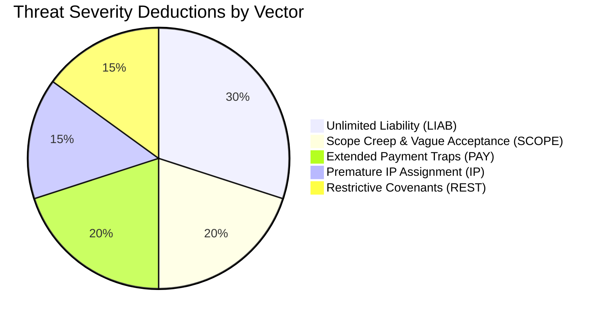

# ClauseGuard Studio — Comprehensive Commercial User Guide
**Standards 4.0 Autonomous Software Studio Specification**  
**Production System:** [https://clause-guard-studio.vercel.app](https://clause-guard-studio.vercel.app)  
**Target Repository:** `iammuttaqi/clause-guard-studio`  
**Version:** 1.0.0 (Production Release)

---

## 1. Introduction & Commercial Overview

### 1.1 The Legal Asymmetry of Independent Practice
Every year, independent software engineers, consultants, creative directors, and boutique agency owners sign hundreds of thousands of client-drafted agreements:
- **Master Services Agreements (MSAs)**
- **Statements of Work (SOWs)**
- **Monthly Retainer Agreements**
- **Non-Disclosure Agreements (NDAs)**

Enterprise procurement departments and corporate legal counsels draft these contracts with one primary goal: **unilaterally offloading commercial, operational, and financial risk onto the external vendor.**

Retaining corporate legal counsel to redline an agreement typically costs **$600 to $1,500 per contract** and takes 3 to 7 business days. For contracts valued between $5,000 and $50,000, retaining legal counsel for every transaction is economically prohibitive. As a result, **over 84% of freelancers and small agencies sign contracts without redlining**, exposing their businesses and personal assets to:
1. **Uncapped Liability & Indemnification**: Personal exposure for indirect, punitive, and third-party claims.
2. **Premature Intellectual Property Assignment**: Loss of legal title to custom deliverables before invoices are cleared.
3. **Subjective Acceptance & Scope Creep**: Uncapped revision rounds triggered by vague "to Client's satisfaction" language.
4. **Predatory Cashflow Terms**: Net-60/90 payment delays and "paid-when-paid" clauses forcing vendors into zero-interest bridge financing.
5. **Overreaching Restrictive Covenants**: Multi-year non-competes barring practitioners from operating in their core market vertical.

**ClauseGuard Studio** eliminates this asymmetry in milliseconds.

```
+--------------------------------------------------------------------------------------------------+
|                                  THE CLAUSEGUARD STUDIO VALUE LOOP                               |
|                                                                                                  |
|   [Client Agreement] ───> [Deterministic Lexical Scan] ───> [5-Vector Threat Matrix]             |
|                                (<15ms, Zero-Knowledge)                   │                       |
|                                                                          ▼                       |
|   [Final Executed Contract] <── [Email Negotiation Script] <── [3-Posture Counter-Clause]        |
|      (Zero Toxic Risk)            (1-Click Copy Ready)         (Collaborative / Firm / Assert)   |
+--------------------------------------------------------------------------------------------------+
```

---

## 2. Quantified Commercial ROI & Financial Justification

Before reviewing the technical workflow, consider the financial justification for incorporating ClauseGuard Studio into your standard client intake workflow.

### 2.1 The Scope Creep Downside Formula
On a standard fixed-price Statement of Work ($12,000 fixed fee, 80 estimated hours at a target rate of $150/hr), an unredlined agreement with subjective acceptance terms typically incurs **3 unbilled revision cycles** (averaging 8 hours per cycle = 24 unbilled hours):

$$\text{Downside Loss} = \text{Unbilled Overrun Hours} \times \text{Target Hourly Rate}$$
$$24 \text{ hours} \times \$150/\text{hr} = \$3,600 \text{ in unbilled revenue leakage}$$

$$\text{Effective Realized Hourly Rate} = \frac{\text{Base Fee}}{\text{Quoted Hours} + \text{Overrun Hours}} = \frac{\$12,000}{80 + 24} = \$115.38/\text{hr} \quad (-23.1\% \text{ margin loss})$$

### 2.2 Return on Investment (ROI) Matrix
| Plan | Investment | Threat Mitigated | Financial Protection Recaptured | Direct ROI Multiplier |
| :--- | :---: | :--- | :--- | :---: |
| **Free Starter** | **$0** | Identifies critical uncapped liability traps | Avoids signing catastrophic indemnity terms | **Infinite** |
| **Pro Monthly** | **$29/mo** | Recaptures 24 hours of scope creep on a single contract | **$3,600** preserved billable fee margin | **124x ROI** |
| **Founder Lifetime Deal** | **$79** *(one-time)* | Eliminates premature IP transfers & paid-when-paid traps | **$5,000 to $40,000** in contract collection leverage | **50x to 500x ROI** |

By preventing a single unbilled revision cycle or inserting a mandatory Net-15 payment term, the software pays for itself on day one.

---

## 3. Getting Started: Ingesting Contracts

ClauseGuard Studio offers two intake pathways: **Pre-Seeded Industry Reference Contracts** and **Custom Contract Ingestion**.

```
+--------------------------------------------------------------------------------------------------+
|                                    WORKSPACE INPUT REGISTRY                                      |
+--------------------+--------------------------------+--------------------+-----------------------+
| Ingestion Mode     | Minimum Length                 | Supported Formats  | Ingestion Time        |
+--------------------+--------------------------------+--------------------+-----------------------+
| Custom Paste       | 100 characters                 | Plain text, UTF-8  | Instant (<1 ms)       |
| Pre-Seeded MSA     | 450 words / ~3,100 characters  | Built-in Template  | 1-Click Pre-fill      |
| Pre-Seeded SOW     | 380 words / ~2,600 characters  | Built-in Template  | 1-Click Pre-fill      |
| Pre-Seeded Retainer| 320 words / ~2,200 characters  | Built-in Template  | 1-Click Pre-fill      |
| Pre-Seeded NDA     | 290 words / ~1,950 characters  | Built-in Template  | 1-Click Pre-fill      |
+--------------------+--------------------------------+--------------------+-----------------------+
```

### 3.1 Loading Pre-Seeded Industry Reference Templates
If you want to evaluate how the scanner detects specific legal traps, use the built-in reference templates:

1. Navigate to the **Auditor Workspace** at [https://clause-guard-studio.vercel.app](https://clause-guard-studio.vercel.app).
2. In the top toolbar of the Contract Editor (left column), locate the **Sample Agreement Selector** dropdown.
3. Select from four canonical commercial agreements:
   - **Enterprise Master Services Agreement (MSA)**: Riddled with uncapped contractor liability, broad consequential damages, one-way defense indemnification, and perpetual warranties.
   - **Agency Design Statement of Work (SOW)**: Contains subjective "client satisfaction" traps, unquoted revision loops, and premature work-for-hire assignment prior to payment.
   - **Monthly Consulting Retainer**: Illustrates Net-90 delayed payout traps, paid-when-paid conditions, and uncompensated full-time exclusivity mandates.
   - **Mutual Non-Disclosure Agreement (NDA)**: Embeds sneak non-compete clauses, 24-month non-solicitation bans, and global territorial lockouts.
4. The Contract Title, Contract Type selector, and editor body will instantly populate.
5. The statistics bar at the bottom will display the word count, character count, line count, and a green badge: **"Ready to Audit"**.

### 3.2 Pasting Custom Client Agreements
To review a real contract from your client or prospective partner:

1. Open your client's draft agreement in Word, Google Docs, or PDF.
2. Highlight and copy the relevant terms (or the entire agreement text).
3. In ClauseGuard Studio, click **"Clear"** in the editor toolbar if text is currently loaded.
4. Paste the text directly into the monospace editor area (`Cmd+V` on macOS or `Ctrl+V` on Windows/Linux).
5. Specify a descriptive **Contract Title** in the input well (e.g., `Acme Corp MSA - Cloud Architecture`).
6. Select the appropriate **Contract Type** (`Master Services Agreement`, `Statement of Work`, `Consulting Retainer`, `NDA`, or `Custom Contract`).
7. Verify that the character count exceeds **100 characters**. Once satisfied, the **"Analyze Contract"** button activates.
8. Click **"Analyze Contract"**. The deterministic engine analyzes the entire payload in under 15 milliseconds.

---

## 4. The 5-Vector Threat Scanner Deep-Dive

ClauseGuard Studio categorizes legal risks into **5 Critical Threat Vectors**, evaluating 25+ specific pattern rules. Each detected violation carries an explanatory advisory and a deduction from your contract's base **Protection Index (0 to 100)**.



### 4.1 Vector #1: Unlimited Liability & Asymmetric Indemnification
*Severity: CRITICAL | Score Impact: Up to -30 Points*

Corporate procurement contracts frequently attempt to make the contractor an insurer of the client's business operations.

#### Detected Toxic Patterns
- **Uncapped Contractor Liability (`LIAB-01`)**: Phrasing such as `"without limitation"`, `"unlimited liability"`, or `"liable for any and all damages"`.
- **Consequential & Lost-Profit Damages (`LIAB-02`)**: Terms permitting recovery of speculative revenue loss, business interruption, or anticipated profits resulting from bugs or delays.
- **One-Way Defense & Indemnification (`LIAB-03`)**: Mandates that the contractor defend and hold harmless the client without requiring reciprocal protection for client-provided assets.
- **Open-Ended Third-Party IP Indemnity (`LIAB-04`)**: Uncapped guarantees that custom code does not infringe any worldwide patent or copyright.
- **Perpetual Warranty (`LIAB-05`)**: 1-to-2-year or perpetual bug-fix guarantees without compensation.

#### Commercial Risk
A single alleged defect could result in a lawsuit seeking damages far exceeding the entire contract value, threatening your corporate entities and personal assets.

---

### 4.2 Vector #2: Scope Creep & Vague Acceptance
*Severity: WARNING | Score Impact: Up to -20 Points*

Fixed-price contracts are highly profitable only when deliverable definitions and acceptance criteria are strictly bounded.

#### Detected Toxic Patterns
- **Subjective Satisfaction Trap (`SCOPE-01`)**: Language conditioning milestone approval on `"to Client's sole satisfaction"` or `"in Client's sole discretion"`.
- **Uncapped Revision Loops (`SCOPE-02`)**: Guarantees of `"unlimited revisions"`, `"revise until approved"`, or `"further modifications at no additional cost"`.
- **Missing Deemed Acceptance Window (`SCOPE-03`)**: Contract review clauses that lack an automatic approval trigger upon client silence.
- **Open-Ended Scope Inclusions (`SCOPE-04`)**: Catch-all phrases like `"all necessary and incidental services"` or `"any other duties as requested"`.
- **Free Lifetime Maintenance (`SCOPE-05`)**: Obligating ongoing bug remediation after project deployment without a retainer agreement.

#### Commercial Risk
Clients can withhold final milestone payments indefinitely while demanding endless visual tweaks, restructuring features, and expanding specifications.

---

### 4.3 Vector #3: Extended Payment Terms & Cashflow Traps
*Severity: CRITICAL | Score Impact: Up to -20 Points*

Without stringent payment mechanisms, enterprise clients leverage small service providers as interest-free credit facilities.

#### Detected Toxic Patterns
- **Paid-When-Paid / Paid-If-Paid (`PAY-01`)**: Conditioning contractor payment on the client receiving remittance from their third-party end customer.
- **Extended Payment Cycles (`PAY-02`)**: Net-60, Net-90, or Net-120 terms delaying compensation for months after delivery.
- **Absence of Late Interest Penalties (`PAY-03`)**: Omitting statutory monthly interest fees on delinquent invoices.
- **Missing Right to Suspend Work (`PAY-04`)**: Clauses legally forcing the contractor to continue work even during payment defaults.
- **Unilateral Fee Withholding & Set-Off (`PAY-05`)**: Allowing clients to unilaterally deduct arbitrary damages or withhold entire invoices based on disputed items.

#### Commercial Risk
Working capital insolvency. If your client's accounts payable department runs on 90-day cycles, your agency must finance payroll and overhead out of pocket.

---

### 4.4 Vector #4: Premature Intellectual Property Assignment
*Severity: CRITICAL | Score Impact: Up to -15 Points*

Intellectual property ownership is your ultimate leverage in commercial contract disputes.

#### Detected Toxic Patterns
- **Work Made For Hire Upon Creation (`IP-01`)**: Clauses stating that work product transfers to the client `"immediately upon creation"` rather than upon cleared payment.
- **Forfeiture of Pre-Existing Background IP (`IP-02`)**: Language assigning `"all prior, background, and proprietary tools, frameworks, and libraries"` used to build deliverables.
- **Broad Waiver of Moral Rights (`IP-03`)**: Prohibiting you from including non-confidential project screenshots in your professional portfolio or case studies.
- **Forfeiture of Unpaid Work-in-Progress (`IP-04`)**: Mandating release of drafts, assets, and source code repositories upon contract cancellation without settlement.

#### Commercial Risk
If legal title transfers upon creation, a defaulting client owns your code or designs immediately. You cannot demand return of deliverables or claim copyright infringement for non-payment.

---

### 4.5 Vector #5: Restrictive Covenants & Non-Compete Overreach
*Severity: WARNING | Score Impact: Up to -15 Points*

Independent contractors must preserve their freedom to operate across their domain of expertise.

#### Detected Toxic Patterns
- **Post-Termination Non-Compete (`REST-01`)**: Restricting the contractor from servicing clients in the same industry or market vertical.
- **Excessive Non-Solicitation (`REST-02`)**: Restrictions exceeding 12 months that prohibit hiring subcontractors or interacting with mutual business contacts.
- **Uncompensated Exclusivity (`REST-03`)**: Mandating full-time, exclusive dedication without an employment contract or guaranteed minimum retainer.
- **Overbroad Geographic Territory (`REST-04`)**: Worldwide or non-specific territorial restrictions on remote advisory services.

#### Commercial Risk
Signing an overbroad non-compete can legally lock you out of your core consulting vertical, destroying your sales pipeline for up to two years.

---

## 5. 1-Click Counter-Clause Generator & Negotiation Postures

Detecting toxic clauses is only half the battle; closing the deal requires **actionable, commercially balanced counter-language**.

ClauseGuard Studio features a **1-Click Counter-Clause Generator** that generates industry-standard, battle-tested replacement language across **three calibrated negotiation postures**.

```
+--------------------------------------------------------------------------------------------------+
|                                    THE 3 NEGOTIATION POSTURES                                    |
+----------------------+--------------------------------+------------------------------------------+
| Posture              | Tone & Rationale               | Best Suited For                          |
+----------------------+--------------------------------+------------------------------------------+
| **Collaborative**    | Relational, compliance-framed, | Early-stage startups, trusted recurring  |
|                      | gentle commercial balance      | clients, sensitive founder relationships |
+----------------------+--------------------------------+------------------------------------------+
| **Firm (Standard)**  | Industry-standard commercial   | Standard B2B agency contracts, mid-market|
|                      | reciprocity, mutual covenants  | corporate clients, technical contracting |
+----------------------+--------------------------------+------------------------------------------+
| **Assertive**        | Strict legal boundaries,       | Aggressive enterprise procurement teams, |
|                      | clear statutory protections    | high-risk clients, fixed-price RFPs      |
+----------------------+--------------------------------+------------------------------------------+
```

### 5.1 Walkthrough: Selecting a Posture and Inspecting Diffs
When an audit flags a clause in the **Threat Vector Accordion**:
1. Click on the flagged vector to expand the detected issues.
2. Each flagged item displays the original offending sentence highlighted in crimson or amber.
3. Beneath the explanation, navigate between the three posture tabs:
   - Click **`Collaborative`** (Handshake icon)
   - Click **`Firm (Standard)`** (Scale icon)
   - Click **`Assertive`** (Shield icon)
4. The replacement language dynamically adjusts to reflect the selected tone.
5. Click the **"Diff View"** toggle (`GitCommitHorizontal` icon) to inspect an inline redline diff:
   - Red strikethrough (`<del>`): Offending predatory phrases removed.
   - Green bold highlight (`<ins>`): Protective terms inserted.

```
Example Redline Diff (LIAB-01 - Contractor Liability):
"Contractor's aggregate liability under this Agreement shall be limited to direct damages and 
[DEL: without limitation under any theory of law] 
[INS: shall be strictly capped at the total fees actually paid to Contractor hereunder in the 
twelve (12) months preceding the event giving rise to liability]."
```

### 5.2 Copying Counter-Clauses and Negotiation Email Scripts
To eliminate friction during contract negotiations, ClauseGuard Studio generates both the redline clause and a copy-paste email negotiation script:

1. **Copy Counter-Clause**: Click the **"Copy Clause"** button (`Copy` icon). The exact replacement text is copied to your clipboard.
2. **Copy Email Script**: Click the **"Copy Email Script"** button (`Mail` icon). A calibrated negotiation brief tailored to your selected posture is copied to your clipboard.

#### Pre-Configured Email Scripts by Posture
- **Collaborative Script**:
  > *"Hi team, we reviewed this section and proposed a slight modification to align with our insurer standard covenants. Please confirm if this updated wording works."*
- **Firm Script**:
  > *"Regarding this clause: as an independent professional firm, our standard practice requires mutual liability caps and cleared payment title transfer. Please approve this redline."*
- **Assertive Script**:
  > *"Our firm disclaims unilateral indemnity and uncapped liabilities. Please incorporate this redline to finalize the contract for execution."*

---

## 6. Scope-Creep Overrun & Downside Financial Calculator

Scope creep does not just create frustration—it silently erodes profit margins. The **Deliverable & Scope Overrun Calculator** allows service providers to model financial downside exposure in real time and attach an enforceable legal addendum to their contracts.

```
+--------------------------------------------------------------------------------------------------+
|                                    OVERRUN FINANCIAL CALCULATOR                                  |
+-----------------------------+------------------------------------+-------------------------------+
| User Inputs (Sliders)       | Mathematical Formula               | Live Output Metrics           |
+-----------------------------+------------------------------------+-------------------------------+
| Quoted Project Fee ($)      | Unbilled Hours = (Anticipated -    | **Unbilled Overrun Hours**    |
| Target Hourly Rate ($/hr)   | Included Rounds) × 8 hrs           | (e.g., +24 hrs)               |
| Quoted Scope Hours (hrs)    |                                    |                               |
| Included Revision Rounds    | Downside Loss = Unbilled Hours ×   | **Downside Financial Loss**   |
| Anticipated Actual Rounds   | Target Hourly Rate                 | (e.g., -$3,600)               |
| Client Review Window (Days) |                                    |                               |
|                             | Realized Rate = Base Fee /         | **Effective Realized Rate**   |
|                             | (Quoted Hours + Overrun Hours)     | (e.g., $115.38/hr [-23.1%])   |
+-----------------------------+------------------------------------+-------------------------------+
```

### 6.1 Step-by-Step Calculator Walkthrough
1. In the results view, locate the **Deliverable & Scope Overrun Calculator** widget (or switch to the standalone "Overrun Calc" tab on mobile).
2. Adjust the 6 interactive model parameters:
   - **Quoted Project Fee ($)**: Base fixed-fee agreed upon (e.g., `$12,000`).
   - **Target Hourly Rate ($/hr)**: Your standard billing baseline (e.g., `$150/hr`).
   - **Quoted Scope Hours (hrs)**: Estimated active development effort (e.g., `80 hrs`).
   - **Included Revision Rounds**: Rounds included in base scope (e.g., `2 rounds`).
   - **Anticipated Client Revisions**: Expected actual feedback iterations (e.g., `5 rounds`).
   - **Review Turnaround Window**: Maximum business days for client inspection (e.g., `5 business days`).
3. Instantly review the 4 calculated metrics:
   - **Unbilled Overrun**: Additional uncompensated hours (`+24 hrs`).
   - **Downside Loss**: Direct fee leakage (`-$3,600`).
   - **Realized Rate**: Degraded hourly rate with percentage drop (`$115.38/hr, -23.1% degradation`).
   - **SLA Buffer Fee**: Recommended contingency buffer (`+$2,400`, 20% of base fee).

### 6.2 Protective Scope Containment SLA Addendum
Beneath the financial metrics, ClauseGuard Studio automatically drafts an enforceable **SLA Contract Rider** incorporating your exact numerical parameters:

```markdown
### Scope Containment & Revision Limit SLA Addendum
1. Revision Allotment: The quoted fee includes exactly two (2) consolidated rounds of 
   stakeholder revisions. All revision requests must be submitted in writing within 
   five (5) business days of deliverable transmission.
2. Deemed Acceptance: If Client does not deliver itemized, written non-conformities 
   within five (5) business days, the deliverables shall be deemed irrevocably accepted.
3. Hourly Overrun Rate: Revisions exceeding the included rounds, or out-of-scope alterations 
   requested following deemed acceptance, shall be invoiced at the mandatory rate of 
   $150.00/hour under a separate written Change Order.
```

Click **"Copy SLA Clause"** to paste this protective rider directly into your Statement of Work.

---

## 7. Standards 4.0 Built-in Monetization & Billing Guide

ClauseGuard Studio is architected with a transparent, frictionless commercial model.

```
+--------------------------------------------------------------------------------------------------+
|                                     PRICING & PACKAGING MATRIX                                   |
+------------------------------------+------------------------------------+------------------------+
| Entitlement / Capability           | Free Starter ($0)                  | Pro Tier ($29/mo or $79 LTD) |
+------------------------------------+------------------------------------+------------------------+
| Monthly Contract Audits            | 3 Scans / calendar month           | Unlimited Audits       |
| Lexical Threat Scanner (5 Vectors) | Included                           | Included               |
| Health Scorecard (0-100 Index)     | Included                           | Included               |
| Severity Badges & Flag Summaries   | Included                           | Included               |
| Counter-Clause Generator           | Editorial Teaser (Blurred)         | Unlocked (3 Postures)  |
| Visual Diff Comparison             | Preview Only                       | Fully Unlocked         |
| Negotiation Email Scripts          | Locked                             | Unlocked (3 Postures)  |
| Scope Overrun Financial Model      | Interactive View                   | Interactive View       |
| Protective SLA Contract Rider      | Locked                             | Unlocked & Copyable    |
| Watermark-Free Export (PDF/MD)     | Watermarked Preview                | Clean Markdown & Print |
| Commercial Agency License          | Personal Use                       | Included               |
| Self-Serve Stripe Customer Portal  | N/A                                | Full Access            |
+------------------------------------+------------------------------------+------------------------+
```

### 7.1 Free Tier vs. Pro Tier
- **Free Starter Plan ($0)**: Perfect for freelancers who audit 1 to 3 contracts per month. You receive complete lexical scans, threat severity flags, and the Protection Index score. Counter-clauses and export downloads display an editorial blur overlay with an upgrade prompt.
- **Pro Tier ($29/month OR $79 Founder Lifetime Deal)**: Designed for active contractors, consultants, and boutique studios. Grants unlimited scans, full 3-posture counter-clauses, copyable negotiation emails, unblurred SLA contract riders, and watermark-free Markdown/PDF exports.

### 7.2 Quota Gating & Upgrade Modals
- Your current plan and remaining scan balance are permanently visible in the top navigation bar (e.g., `Free Plan: 2/3 Audits Left`).
- If a Free user initiates a 4th scan within a 30-day window, execution safely halts and presents the **Upgrade Modal** (HTTP 402 Payment Required).
- Attempting to unlock a counter-clause or export a clean report from the Free tier immediately opens the pricing comparison modal.

### 7.3 Stripe Hosted Checkout vs. Interactive Sandbox Mode
ClauseGuard Studio provides dual checkout infrastructure:

1. **Production Mode (Live Stripe Checkout)**:
   - Click **"Upgrade to Pro Monthly ($29/mo)"** or **"Founder Lifetime Access ($79)"**.
   - You are redirected to Stripe's secure hosted payment page.
   - Upon successful payment, Stripe webhooks update your account tier atomically, instantly unlocking all Pro features.
2. **Interactive Sandbox Simulator (Zero-Friction Preview)**:
   - For evaluation, offline testing, or demonstration environments where live payment credentials are not present, ClauseGuard Studio includes an **Interactive Sandbox Toggle**.
   - Located in the application header (`Sandbox Mode` switch) and inside the upgrade modal.
   - Click the switch to toggle between **Free** and **Pro** modes instantly.
   - When Pro is simulated, all locked features, counter-clauses, and exports unlock reactively without page reloads or network latency.

---

## 8. Zero-Knowledge Privacy & Security Architecture

Contract confidentiality is paramount. Client Master Services Agreements routinely contain strict non-disclosure obligations. **Pasting client contracts into cloud LLMs (such as ChatGPT, Claude, or third-party AI APIs) frequently constitutes a material breach of confidentiality.**

ClauseGuard Studio was engineered from the ground up under a **Zero-Knowledge Architecture**:

```
+--------------------------------------------------------------------------------------------------+
|                              ZERO-KNOWLEDGE SECURITY PIPELINE                                    |
|                                                                                                  |
|  [Client Contract Text]                                                                          |
|            │                                                                                     |
|            ▼                                                                                     |
|  [Deterministic Lexical Tokenizer] ─── (Runs entirely in browser / ephemeral serverless runtime)  |
|            │                                                                                     |
|            ├── 100% Deterministic Regex & Pattern Matchers (25+ Legal Rules)                     |
|            ├── ZERO External LLM API Calls (No OpenAI, No Anthropic, No Gemini)                  |
|            ├── ZERO External Data Transmission                                                   |
|            └── ZERO Training on Your Contract Content                                            |
|            │                                                                                     |
|            ▼                                                                                     |
|  [Local Redlines & Output Display]                                                               |
+--------------------------------------------------------------------------------------------------+
```

### 8.1 Key Privacy Guarantees
1. **Zero External LLM Inference**: ClauseGuard Studio does not transmit contract payloads to external LLM providers or third-party APIs.
2. **Deterministic Pattern Recognition**: Analysis is performed by high-precision, curated lexical tokenizers and rule matchers. The engine never hallucinates legal clauses or legal citations.
3. **No Contract Data Storage for Training**: Contracts are never indexed, aggregated, or utilized for model training.
4. **Ephemeral Serverless Processing**: If analyzed via Nitro serverless endpoints, contract text is evaluated in memory and discarded immediately upon response generation.
5. **Client Confidentiality Compliance**: You can safely audit proprietary client code, trade-secret agreements, and high-security enterprise SOWs without violating non-disclosure covenants.

---

## 9. Keyboard Shortcuts & Power-User Workflows

For professional practitioners who audit multiple contracts weekly, ClauseGuard Studio supports streamlined keyboard navigation and high-efficiency commercial workflows.

```
+--------------------------------------------------------------------------------------------------+
|                                  KEYBOARD SHORTCUTS REFERENCE                                    |
+--------------------------+-----------------------+-----------------------------------------------+
| Action                   | macOS Shortcut        | Windows / Linux Shortcut                      |
+--------------------------+-----------------------+-----------------------------------------------+
| Paste Contract Text      | `Cmd + V`             | `Ctrl + V`                                    |
| Select All Text in Editor| `Cmd + A`             | `Ctrl + A`                                    |
| Clear Editor Text        | Click `Clear` Toolbar | Click `Clear` Toolbar                         |
| Focus Contract Title     | `Tab` (from Selector) | `Tab` (from Selector)                         |
| Navigate Posture Tabs    | `Arrow Left / Right`  | `Arrow Left / Right` (Radix Tabs)             |
| Expand Threat Accordion  | `Enter` / `Space`     | `Enter` / `Space` (Radix Accordion)           |
| Close Dialog / Modal     | `Escape`              | `Escape`                                      |
+--------------------------+-----------------------+-----------------------------------------------+
```

### 9.2 The 90-Second Fast Redline Workflow
Follow this standard operating procedure whenever a new client drops an agreement into your inbox:

1. **Step 1: Paste Text (`0:00 - 0:15`)**  
   Copy the client agreement text and paste it into the ClauseGuard Studio Contract Editor.
2. **Step 2: Trigger Analysis (`0:15 - 0:20`)**  
   Click **"Analyze Contract"**. In under 15ms, review the overall **Protection Index (0-100)** and identify critical crimson flags.
3. **Step 3: Calibrate Counter-Clauses (`0:20 - 0:50`)**  
   Expand the flagged vectors (e.g., Liability, IP, Payment). Choose your negotiation posture (**Firm** for enterprise clients; **Collaborative** for startups).
4. **Step 4: Configure Scope Overrun Limits (`0:50 - 1:10`)**  
   Adjust the Overrun Calculator to match your project fee and revision round caps. Copy the customized SLA Addendum Rider.
5. **Step 5: Export & Send Negotiation Email (`1:10 - 1:30`)**  
   Click **"Export Redlines"** to download the clean Markdown report, or click **"Copy Email Script"** on each flagged clause to assemble your redline email response.

---

## 10. Frequently Asked Questions (FAQ)

### Does ClauseGuard Studio provide legal advice?
No. ClauseGuard Studio is an automated commercial analysis tool and workflow utility designed for contract auditing and negotiation preparation. It does not establish an attorney-client relationship. For complex multi-jurisdictional litigation or high-value equity transactions, consult qualified legal counsel.

### Why deterministic lexical heuristics instead of an LLM?
Large Language Models frequently hallucinate statutory interpretations, invent fictitious case citations, and produce non-deterministic outputs. Crucially, sending proprietary client contracts to external LLM APIs breaches most enterprise confidentiality agreements. ClauseGuard Studio's deterministic engine is instantaneous (<15ms), 100% reproducible, completely private, and battle-tested against real freelance disputes.

### How does the Founder Lifetime Deal work?
The Founder Lifetime Deal ($79 one-time payment) grants permanent, unrestricted access to all Pro features, including unlimited contract audits, all future threat vectors, watermark-free exports, and commercial agency rights without recurring monthly fees.

---

*ClauseGuard Studio — Standards 4.0 Autonomous Software Studio Specification.*  
*Live Application: [https://clause-guard-studio.vercel.app](https://clause-guard-studio.vercel.app)*
